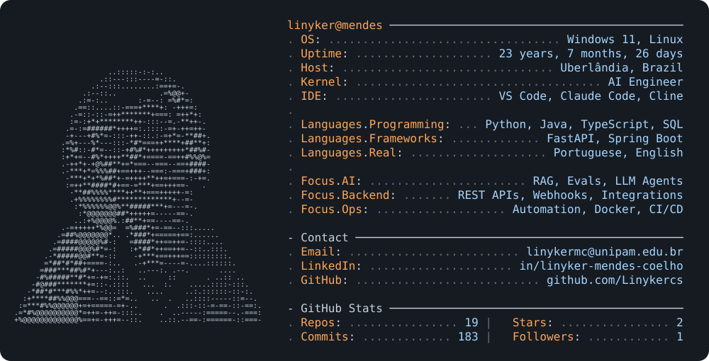

<a href="https://github.com/Linykercs">
  <picture>
    <source media="(prefers-color-scheme: dark)" srcset="dark.svg">
    <source media="(prefers-color-scheme: light)" srcset="light.svg">
    
  </picture>
</a>

[Portfólio](https://linykercs.github.io/portfolio) · [LinkedIn](https://www.linkedin.com/in/linyker-mendes-coelho) · [E-mail](mailto:linykermc@unipam.edu.br)

### Projetos em destaque

**[assistente-docs-rag](https://github.com/Linykercs/assistente-docs-rag)**: responde dúvidas sobre a documentação da API do Asaas citando a fonte, com uma suíte de evals no CI. As evals mostraram que o gargalo estava no contexto, não no modelo: ajustando o retrieval, a corretude do mesmo modelo foi de 4 para 8 em 10.
`Python` `FastAPI` `PostgreSQL + pgvector` `Docker` `GitHub Actions`

**[painel-incidentes](https://github.com/Linykercs/painel-incidentes)**: painel de incidentes e SLA por cliente, sincronizado com o ClickUp, em uso no suporte desde julho de 2026. Prazo em horas úteis por severidade e alerta no Google Chat. [Demo com dados fictícios](https://linykercs.github.io/painel-incidentes/).
`JavaScript` `Firebase` `GitHub Actions` `API do ClickUp`

**[fluxo-caixa](https://github.com/Linykercs/fluxo-caixa)**: sistema de fluxo de caixa multiempresa em produção, com lembretes por Telegram e WhatsApp e assistente de ajuda com IA.
`TypeScript` `Fastify` `Prisma` `React` `Vitest`

**[alfred-bot](https://github.com/Linykercs/alfred-bot)**: assistente financeiro no WhatsApp. Um modelo pequeno classifica a intenção da mensagem e um maior extrai valor, categoria e data.
`Node.js` `Groq` `Baileys` `React`

**[Plim](https://github.com/Linykercs/Plim)**: app para crianças em reabilitação pélvica, feito com estomaterapeutas.
`React Native` `Expo` `TypeScript`

O cartão acima é gerado por <a href="scripts/generate.ps1">um script</a> e atualizado todo dia por <a href=".github/workflows/update-card.yml">GitHub Actions</a>.
