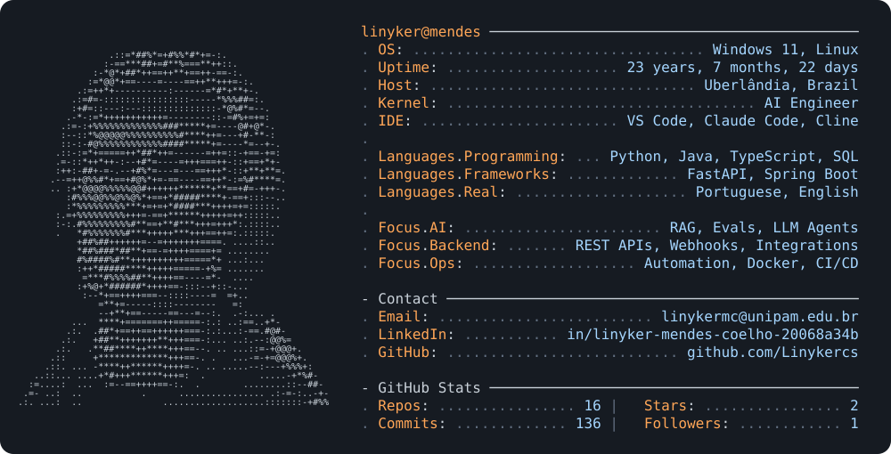

<a href="https://github.com/Linykercs">
  <picture>
    <source media="(prefers-color-scheme: dark)" srcset="dark.svg">
    <source media="(prefers-color-scheme: light)" srcset="light.svg">
    
  </picture>
</a>

[Portfólio](https://linykercs.github.io/portfolio) · [LinkedIn](https://www.linkedin.com/in/linyker-mendes-coelho) · [E-mail](mailto:linykermc@unipam.edu.br)

### Projeto em destaque

**[assistente-docs-rag](https://github.com/Linykercs/assistente-docs-rag)** — assistente que responde dúvidas sobre a documentação da API do Asaas, com RAG, respostas com fonte e avaliação automática (evals).
`Python` `FastAPI` `PostgreSQL + pgvector` `Docker` `GitHub Actions`

O cartão acima é gerado por <a href="scripts/generate.ps1">um script</a> e atualizado todo dia por <a href=".github/workflows/update-card.yml">GitHub Actions</a>.
